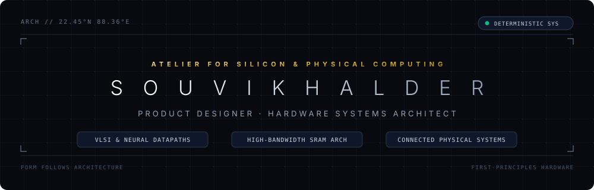

<div align="center">



<br/>

> *“True luxury in engineering is determinism — where silicon microarchitecture, physical constraints, and intuitive product intent converge into seamless elegance.”*

</div>

<br/>

---

### [01] PHILOSOPHY & MANIFESTO

Operating at the intersection of **industrial product design** and **silicon systems architecture**. Rather than treating hardware as disconnected abstraction layers, every system is approached from first principles:

* **From Gate to Enclosure**: Every microarchitectural decision — from register bit-growth and clock domain partitioning to thermal dissipation and tactile form — serves the overarching product intent.
* **Deterministic Precision**: In high-performance compute and edge neural inference, predictability is paramount. Datapaths are architected with zero stall cycles, bounded latencies, and mathematical guarantees against numerical overflow.
* **Radical Efficiency**: Unnecessary silicon area and parasitic capacitance are systematically eliminated through intelligent multi-banking and balanced pipelining (*“Less, but better”*).

---

### [02] ARCHITECTURAL INDEX // SELECTED SYSTEMS

#### PILLAR I: SILICON & NEURAL COMPUTE DATAPATHS
Hardware-efficient computational engines designed for deep learning inference, edge DSP, and matrix tensor operations.

| Architecture | Microarchitecture Highlights | Repository |
| :--- | :--- | :---: |
| **Pipelined Parallel MAC** | 3-stage balanced pipeline, 9 parallel multipliers, registered adder tree, continuous 1 vector/cycle throughput (Fmax >= 350 MHz on Artix-7). | [`souvk99/Parallel_MAC`](https://github.com/souvk99/Parallel_MAC) |
| **Sequential MAC w/ RegFile** | Local 9-entry signed register file (`kernel_buff`), dual-phase execution, strict priority logic, 21-bit overflow-proof accumulator. | [`souvk99/Sequential_MAC_RegFile`](https://github.com/souvk99/Sequential_MAC_RegFile) |
| **Sequential Dot-Product MAC** | Classical 8-bit iterative MAC with FSM sequencing, single multiplier silicon reuse, full Artix-7 verification. | [`souvk99/Sequential_MAC`](https://github.com/souvk99/Sequential_MAC) |

---

#### PILLAR II: MEMORY HIERARCHIES & DATAFLOW ENGINES
High-bandwidth, low-latency storage architectures and addressing engines eliminating memory bottleneck stalls.

| Architecture | Microarchitecture Highlights | Repository |
| :--- | :--- | :--- |
| **CNN Sliding Window Subsystem** | 4-bank column-interleaved SRAM with Modulo-4 staggering and spatial rotation crossbar. Fetches 3x1 pixel windows in 1 cycle with **zero bank collisions**. | [`souvk99/CNN_SRAM_Address_Gen`](https://github.com/souvk99/CNN_SRAM_Address_Gen) |
| **4-Bank Partitioned SRAM** | 64 KB storage partitioned into four 16 KB macro banks; 1-hot chip select decoding reduces bitline parasitic capacitance and dynamic power. | [`souvk99/SRAM_4Bank`](https://github.com/souvk99/SRAM_4Bank) |
| **Monolithic Synchronous SRAM** | High-density 16,384 x 32-bit SRAM block with single-cycle synchronous access and BRAM mapping. | [`souvk99/SRAM_64KB`](https://github.com/souvk99/SRAM_64KB) |

---

#### PILLAR III: CYBER-PHYSICAL & CONNECTED SYSTEMS
End-to-end edge compute nodes, wireless telemetry systems, and embedded hardware architectures.

| System | Focus & Domain | Repository |
| :--- | :--- | :--- |
| **LoRaWAN / RFID Telemetry** | Low-power long-range wireless sensor networks, industrial RF communication, and edge telemetry. | [`souvk99/RFID_RAK_LORAWAN`](https://github.com/souvk99/RFID_RAK_LORAWAN) |
| **End-Node System Architecture** | Embedded hardware-software co-design, deterministic microcontroller firmware, and sensor integration. | [`souvk99/End_node_software_hardware_architecture`](https://github.com/souvk99/End_node_software_hardware_architecture) |
| **Embedded Vision Hardware** | Video capture pipeline, real-time edge streaming, and robust power delivery design. | [`souvk99/Dashcam_project`](https://github.com/souvk99/Dashcam_project) |

---

### [03] SYSTEM STACK // CORE COMPETENCIES

```
                        +-----------------------------------------------+
                        |          PRODUCT VISION & ENCLOSURE           |
                        +-----------------------+-----------------------+
                                                |
                        +-----------------------v-----------------------+
                        |      HARDWARE-SOFTWARE CO-DESIGN & EMBEDDED   |
                        |   (C/C++, Firmware, Industrial LoRaWAN, RTOS) |
                        +-----------------------+-----------------------+
                                                |
                        +-----------------------v-----------------------+
                        |       DIGITAL SYSTEM & RTL ARCHITECTURE       |
                        |  (Verilog-2001, Vivado, FSMs, Pipelined MACs) |
                        +-----------------------+-----------------------+
                                                |
                        +-----------------------v-----------------------+
                        |     MEMORY ARRAYS & SILICON DATAFLOW PATHS    |
                        |    (Interleaved SRAM Macros, Bank Crossbars)  |
                        +-----------------------------------------------+
```

| Domain | Core Competencies & Toolchain |
| :--- | :--- |
| **Silicon & RTL Design** | Verilog-2001, AMD Vivado Design Suite, Logic Simulation (XSim, Icarus), Pipelined Datapaths, FSM Design |
| **Memory Architecture** | Interleaved Multi-Banking, BRAM Optimization, SRAM Macro Partitioning, Address Generation Crossbars |
| **Physical & Verification** | Zero-Overflow Mathematical Proofs, Collision-Free Banking Theorems, Cycle-Accurate Testbenches |
| **Product Engineering** | System Requirements Translation, First-Principles Modeling, Embedded IoT, Wireless Telemetry |

---

### [04] CONTACT // COLOPHON

* **Identity**: Souvik Halder
* **Discipline**: Product Designer // Hardware Systems Architect // Cybersecurity
* **Inquiries**: [doc15833@gmail.com](mailto:doc15833@gmail.com)
* **GitHub**: [@souvk99](https://github.com/souvk99)

<div align="center">
<sub>Designed with architectural restraint and first-principles discipline. (C) 2026 Souvik Halder</sub>
</div>
